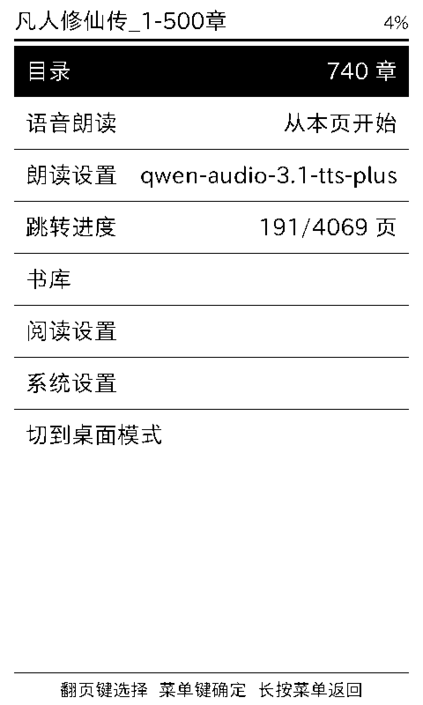
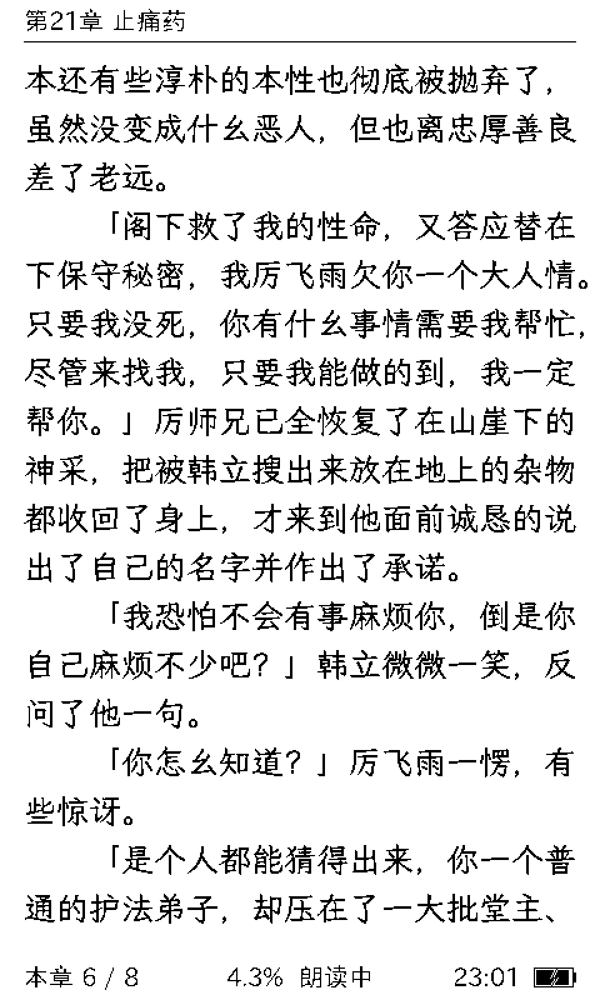
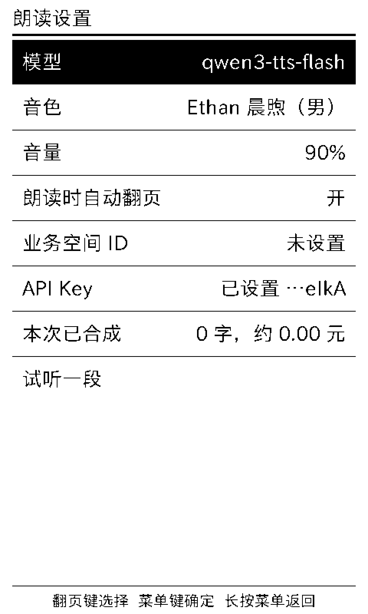

# 墨水屏阅读器固件（PCB1，ESP32-S3）

v0.3.0 · 2026-11-23 · 屏：4.26 寸 GDEY0426T82（SSD1677，800×480，219 PPI）。4.2 寸 SSD1619A 测试屏的驱动还在，见文末。

## 功能

- **两种模式，按姿态自动切换**：竖拿是阅读模式；横放在支架上是桌面模式。倒着拿时画面转 180°，上一页和下一页两个键自动对调。
- **桌面模式**（版式见 `docs/mockups-426/桌面A_细化.png`，固件实际画出来的样子见 `桌面_固件渲染.png`）：
  - 顶行：日期、星期；右边农历、节气（最近的一个）、电量（用电池且电量低时前面反白"电量低"，充电时电池里有闪电）。
  - 左边大时钟（Barlow Condensed，字号按最宽的时间定，不会一分钟大一分钟小）；右边细竖线隔出二氧化碳、温度、湿度三项，二氧化碳 ≥ 1000 ppm 时标签旁反白"该开窗了"。没有 CO2 传感器（温湿度也是从它读的）就不要右栏，时钟整行居中。
  - 底部：在读的书名、当前章节、进度百分比，最下面一条细线当进度条。
  - 没对时：不显示假的时间，写"还没对时"和去哪里设置。
  - 农历和节气查表（`core/lunar.*`，表由 `tools/gen_lunar.py` 生成，公历 2000～2100 年，`tools/lunartest` 和 lunar_python 逐日对过）。
- **看书**：TF 卡 `/books/`（含两层子文件夹）和根目录里的 **TXT** 和 **EPUB**。
  - TXT 支持 UTF-8（带不带 BOM 都行）、GBK / GB2312、UTF-16，打开时自动识别编码。
  - EPUB（2 和 3 都行）只取文字：图片、样式不显示。书名用书里写的；目录用书里自带的。书里没有像样的目录（少于 3 条）时，就按"第X章 / 第X回"的规则从正文里认。
  - 自动认出章节（"第十二章""卷三""第一〇回""Chapter 3""序章""番外"……，简繁体都认），可以按目录跳转。每章从新的一页开始，标题居中加粗。
  - 排版：段首缩进两字、两端对齐、句末标点可以挂在行尾、左引号和左括号不留在行尾、英文单词不从中间断开。
  - 菜单、目录里界面字体没有的字（繁体、生僻字）用正文字库补上。
  - 书多大都能读（电脑上用 26MB、约九百万字的 TXT 测过导入和分页）。内存里只放阅读位置附近的一段：整本放得下（≤ 4.5MB 正文）就整本，放不下就放全书的 20%（最少 1MB，最多 4.5MB），翻出这一段再从卡上补，顺着往后读时每次只补半段。
  - **阅读缓存**：第一次打开一本书时"导入"——转成统一的 UTF-8 正文，同时扫出章节和标题，存在卡上 `/.reader/`（屏上显示"正在导入 x%"）；然后排一遍版、存下分页表（"正在排版 x%"）。以后再打开、深睡醒来、换回用过的字号都直接读缓存，不用再等。书的文件改了（大小、修改时间、开头内容变了）会自动重新导入。缓存最多留 30 本（最久没读的先删）；系统设置里"清除阅读缓存"可以全部删掉重建，阅读进度不受影响。
  - 阅读进度按"在正文里的位置"记，每本书分开存。换字号、换行距以后还在原来的位置。
- **字体**：正文用卡上 `/fonts/` 里的点阵字库（4.26 寸屏用霞鹜文楷 22/24/26/28，默认 24），菜单里可以换字体、字号、行距、页边距。界面（菜单、页眉页脚、提示框）用嵌在固件里的霞鹜新晰黑 26 / 20 号（`data/ui_big.efnt`、`ui_small.efnt`，GB2312 简体子集，OFL 许可，见 `data/FONTS.md`），没有的字用正文字库补。阅读页脚左边是本章第几页，中间是全书进度。
- **语音朗读**：按句流式合成（阿里云百炼 `qwen3-tts-flash`），边下载边播放；朗读时自动翻页，上一页/下一页键切换上一句/下一句，双击后背暂停。见下文"语音朗读"。
- **省电**：用电池时，空闲几秒就浅睡（按键、敲击马上醒）。空闲超过设定的时间（默认 10 分钟）就深睡：阅读界面在页脚标"休眠中"，按任意键醒来，接着翻页；桌面界面每分钟醒一次更新时钟。插着 USB 不睡（方便调试和烧录）。
- **低电量**：用电池时电压连续两次低于 3.3V，刷"电量低，请充电"后关机。

## 按键

| | 短按 | 长按 |
|---|---|---|
| 下一页键 | 阅读：下一页<br>菜单：光标下移 | 阅读：下一章（没有章节就连续翻页）<br>菜单：翻一屏 |
| 上一页键 | 阅读：上一页<br>菜单：光标上移 | 阅读：回到本章开头，已经在开头就到上一章 |
| 菜单键 | 打开菜单，菜单里是"确定" | 阅读：打开目录<br>桌面：切到阅读<br>菜单：返回 |
| 电源键 | 全屏刷新一次（清残影） | 3 秒：开机 / 关机 |

双击后背也能翻到下一页（设置里可以关）。朗读时双击后背是暂停 / 继续。

## 菜单

- **阅读时**：目录、语音朗读（或暂停/继续、上一句、下一句、停止）、朗读设置、跳转进度、书库、阅读设置、系统设置、切到桌面模式
- **桌面时**：继续阅读、书库、系统设置
- **阅读设置**：字体、字号、行距（紧凑 / 标准 / 宽松）、页边距、全刷间隔（每 1～20 页）、双击后背翻页
- **朗读设置**：音色、音量、朗读时自动翻页、API Key、试听一段
- **系统设置**：横放自动切到桌面（躺着看书时关掉）、自动休眠（5～60 分钟 / 从不）、设置时间、姿态校准、全屏刷新、关于本机、恢复默认设置

## 语音朗读（qwen3-tts-flash / qwen-audio-3.1-tts-plus）

按句流式合成、边下边播：读到哪句就把哪句发给阿里云百炼，服务端一边生成一边返回音频，
设备收到就送功放（24kHz、16bit）；后面一两句同时在后台合成，句子之间基本听不出停顿。

两个模型可以切换（朗读设置 → 模型，或串口 `tts model flash|plus`）：

| 模型 | 价格（北京） | 特点 |
|---|---|---|
| **qwen3-tts-flash**（默认） | 0.8 元/万字符 | 便宜、够用，7 个音色 |
| **qwen-audio-3.1-tts-plus** | ≈1.44 元/万字符 | 专业级音质、方言、指令控制；需要业务空间 ID；控制台有时送免费额度 |

**配置**：先配网（系统设置 → Wi-Fi → 配网），再进 系统设置 → Wi-Fi → 无线传输，手机或电脑打开设备网址，
在"语音朗读"那一栏填百炼的 API Key（`sk-` 开头，存在设备的 NVS 里，只用来说书），选模型；
用 plus 还要填**业务空间 ID**（百炼控制台首页右上角图标弹出的对话框里复制，或业务空间管理里的 Workspace ID 列）。
也可以串口：

```
tts key sk-xxxxxxxx
tts model plus            # 切到 qwen-audio-3.1-tts-plus；tts model flash 切回来
tts ws llm-xxxxxxxx       # 业务空间 ID（plus 用；tts ws clear 清除）
tts model                 # 看当前模型和价格
```

**用**：阅读时按菜单键 → **语音朗读**（从本页开始）。朗读时：

| 操作 | 作用 |
|---|---|
| 上一页 / 下一页键短按 | 上一句 / 下一句 |
| 上一页 / 下一页键长按 | 上一章 / 下一章开头（接着念） |
| 双击后背 | 暂停 / 继续 |
| 菜单键 | 菜单（暂停、继续、上一句、下一句、停止朗读、朗读设置） |
| 长按菜单键 | 停止朗读 |



朗读时页脚显示"朗读中"，页面自动跟着正在念的那一句翻：



音色：
- `qwen3-tts-flash`：Cherry 芊悦、Serena 苏瑶、Ethan 晨煦、Chelsie 千雪、Dylan 晓东（京腔）、Jada 阿珍（沪语）、Sunny 小雅（川话）。
- `qwen-audio-3.1-tts-plus`：龙安灵心、许南川、龙安欢、龙安风悦（`longanlingxin_v3.1` 等）。

朗读设置里还有"本次已合成"，显示这次已经合成多少字、大约多少钱（按模型单价估算）。



**实现**（`src/voice/`）：

- `sentence.cpp`：按句切分。`。！？…；` 断句，句末的右引号算进来；没标点的诗、对话在换行处断；
  超过 120 字就在一句里最后的 `，、：` 处断，没有就硬断；纯标点的句子跳过。纯 C++，电脑上能测。
- `tts_client.cpp`：一句一次 HTTP POST（`X-DashScope-SSE: enable`），边收边解。
  flash 走多模态生成接口、返回 WAV（RIFF 头 + 24kHz/16bit/单声道 PCM，`data` 长度字段是假的）；
  plus 走 `SpeechSynthesizer` 接口（地址里带业务空间 ID），直接要 `format: pcm`、24kHz。
  `sse_pcm.cpp` 在字节流里找 `"data":"`，base64 增量解码，有 WAV 头就剥掉；服务端如果没走 SSE
  （只返回音频网址），会再下载一遍。
  注：千问 AI 平台的 SDK 示例（`dashscope.audio.tts_v2`）走的是 WebSocket + MP3；这里用的是同一模型的
  HTTP 接口、直接要 PCM，省掉 WebSocket 和 MP3 解码，ESP32 上更省资源。
- 实测一句 28 字：0.48 秒出第一段音频，1.43 秒合成完 5.7 秒的声音（比实时快约 4 倍），
  所以后面几句来得及提前合成。
- `tts.cpp`：一个主线程 + 两个任务。主线程按句取文、排队、跟着正在播的那句自动翻页；
  合成任务一句一句请求，把 PCM 写进 PSRAM 环形缓冲（320KB，约 6.7 秒）；播放任务从缓冲取出来送 I2S。
  每句 PCM 在流里的字节范围都记着，所以"现在读到哪句"是准的（暂停时也准）。
- 朗读期间 Wi-Fi 一直开着（`net::busy()` 不让睡）；停止、念完、或者暂停超过 5 分钟就关 Wi-Fi。
  朗读时 CPU 开到 240MHz（TLS 和 base64），结束回到 80MHz。

可调参数在 `src/config.h`：`TTS_MAX_CHARS`（一次最多多少字，默认 120）、`TTS_RING_KB`（预读缓冲，默认 320）、
`TTS_RATE`、`TTS_PRICE_FLASH` / `TTS_PRICE_PLUS`（只用于显示估算花费）。用新加坡地域的 Key 时把
`TTS_API_URL` 换成 `dashscope-intl` 的地址，plus 的域名后缀也要改成 `ap-southeast-1`。

**注意**：

- 一句话一次请求，按字符计费；同一句来回翻会重复请求。
- 按 0.8 元/万字符算，一页约 3.6 分、一章（约 3600 字）约 2.9 毛。plus 大约是这个的 1.8 倍。
- 只支持 2.4GHz Wi-Fi。信号弱、网络慢的时候，句子之间会有停顿（预读缓冲垫不住的时候）。
- 暂停后 5 分钟自动停止并关 Wi-Fi，免得忘了还连着网耗电。
- 用电池朗读很费电：Wi-Fi 一直连着、CPU 240MHz、功放也在响。要听一路，最好插着 USB 或充满电。

先在电脑上确认 Key 和返回格式对不对（不用烧固件）：

```
python tools/tts_probe.py sk-xxxxxxxx
```

它打印首段延迟、收到多少字节、采样率 / 声道 / 位深、估计时长，并把长度正确的 WAV 存成 `tts_probe.wav`，电脑上直接能听。

## TF 卡上的文件

```
/books/*.txt *.epub  书，也可以放在子文件夹里（/books/作者/书名.epub，最多两层）。根目录下的也认。
                     . 和 _ 开头的文件和文件夹不列
/fonts/名字_字号.efnt  点阵字库，例如 wenkai_18.efnt
```

没有读卡器时可以用 USB 串口传文件（板子插着 USB、跑着本固件）：

```
python tools/tfcard.py put 小说.txt /books/
python tools/tfcard.py ls /books
python tools/tfcard.py rm /books/小说.txt
```

Python 用 PlatformIO 自带的：`%USERPROFILE%\.platformio\penv\Scripts\python.exe`。

## 做字库

```
python tools/makefont.py LXGWWenKaiGBScreen.ttf --sizes 14 16 18 20 --name wenkai --out 输出目录 --preview
```

默认 `--mode auto`，按字号选渲染方式：

- **16 号及以下用 `mono`**（FreeType 单色 hinting）：笔画对齐像素，小字完整。用 `ss` 的话细笔画会断。
- **18 号及以上用 `ss`**：放大 4 倍渲染，再缩回来取阈值（默认 150）。`mono` 在这个字号会把有的字笔画变成 2 像素，看起来一会儿粗一会儿细。

`--thr` 调 `ss` / `aa` 的粗细，数字越小越粗。需要 `pillow`、`fonttools`。

`ss` 默认阈值 135（11-13 由 150 改）。对 GB2312 一级 3755 字逐字比较“1 位点阵的连通块数”和“8 倍参考渲染的连通块数”，多出来的就是断笔：

| 字体 | 22px 断笔 | 24px 断笔 | 说明 |
|---|---|---|---|
| 霞鹜文楷 Screen，阈值 150 | 66 | 16 | 钩、点和主笔断开一个像素 |
| **霞鹜文楷 Screen，阈值 135** | **7** | **1** | 现在卡上的 `wenkai_*`，笔画粗约 8% |
| 霞鹜新晰黑，阈值 135 | 5 | 3 | 卡上的 `xinhei_*`，黑体备选 |
| 霞鹜文楷 Regular（非 Screen） | 737 | 380 | 笔画太细，别用 |
| 思源宋体 SemiBold | 2122 | 2033 | 横笔太细直接消失，宋体都不适合这块 219PPI 纯黑白屏 |

文楷用 `LXGWWenKaiGBScreen.ttf`，新晰黑用 `LXGWNeoXiHei.ttf`（`--name xinhei`，菜单里显示“霞鹜新晰黑”）。

字体名会显示在菜单里：`wenkai` 显示为"霞鹜文楷"。其他名字的对照表在 `src/text/font.cpp` 的 `fontFamilyLabel()`。

## 编译、烧录、调试

**平时用串口升级**（板子开着、跑着本固件就行，不用按电源键）：

```
pio run -e pcb1_serial -t upload --upload-port COM6
```

固件经 USB 串口发给正在运行的程序，写进另一个程序区（16MB flash 分了 app0 / app1 两个），SHA256 校验通过才切换启动分区，然后软件重启。软件重启不会放掉 GPIO4（PWR_HOLD）的保持，所以不断电。中途断了、校验不过，还是从原来的程序区启动，不会变砖。2MB 固件约 15 秒。也可以直接 `python tools/fwupdate.py [firmware.bin]`。

**升级后先试运行**（串口、网页、联网三种升级都一样）：新固件第一次启动时处于试运行状态，满 30 秒、或者关机 / 深睡 / 开始下一次升级之前自动确认。确认之前只要重启过（崩溃、按 RESET、断电），bootloader 就退回原来的固件。所以升级完 30 秒内别按 RESET。`info` 第一行会显示"试运行中"或"上次升级已退回"。代码在 `src/core/ota.cpp`。

**联网升级**（设备上点"系统设置 → 检查新版本"才联网查，不定时查、不自动装）：

1. 把 `src/config.h` 的 `OTA_URL` 改成你服务器上 version.json 的网址（必须是 HTTPS，证书由固件里自带的根证书包校验）
2. 发版：改 `FW_VERSION` → `pio run` → `python tools/release.py --notes "更新说明"`，生成 `app/dist/firmware-<版本>.bin` 和 `app/dist/version.json`
3. 两个文件传到 `OTA_URL` 所在的目录，**先传 bin、后传 version.json**

设备查到比本机新的版本，会显示版本号和更新说明，按菜单键确定才下载安装；用电池时电量要 30% 以上。下载完校验通过才切换，然后重启进新固件试运行。

**普通烧录**（板子里的固件跑不起来时）：

```
pio run -e pcb1 -t upload --upload-port COM6
```

烧录时要一直按住电源键（或者 R33 点锡），直到烧完：烧录器会先硬复位芯片，复位那一下 GPIO4 放开、PWR_HOLD 掉了就断电，跟板子里原来是什么固件无关。

串口 115200，输入 `help` 看全部命令。常用的：

| 命令 | 作用 |
|---|---|
| `n` / `p` / `m` | 下一页 / 上一页 / 菜单键 |
| `k ml`、`k dl` | 模拟长按菜单键、长按下键（`u` 是上键） |
| `shot` | 截图；电脑上用 `python tools/shot.py COM6 out.png` 收成 PNG |
| `book`、`book 2` | 列出书 / 打开第 2 本 |
| `toc`、`goto 50` | 打印目录 / 跳到 50% |
| `font wenkai 18` | 换字库 |
| `info`、`set` | 状态 / 当前设置 |
| `pf 20 10` | 局刷波形（变黑帧数、变白额外帧数） |
| `deep 15` | 马上深睡，15 秒后醒（测试唤醒流程） |
| `time 2026-11-10 21:30:00` | 对时 |
| `beep 1000 500 30`、`scale`、`sweep` | 测喇叭：单音（Hz、毫秒、音量 %）/ 音阶 / 扫频 100～8000Hz。功放 U9 NS4168，I2S 16kHz，代码在 `board/audio.cpp`；插 USB 时音量最多按 70% 放 |
| `tts` | 朗读状态（模型、音色、音量、Key、业务空间 ID、本次合成字数和估算花费） |
| `tts key sk-...`、`tts key clear` | 保存 / 清除语音服务的 API Key |
| `tts model flash\|plus`、`tts model` | 切换模型 / 看当前模型和价格 |
| `tts ws 业务空间ID`、`tts ws clear` | 设置 / 清除业务空间 ID（plus 用） |
| `tts play`、`tts stop`、`tts next`、`tts prev` | 从当前页开始念 / 停止 / 下一句 / 上一句 |
| `tts say 一段文字` | 直接合成一段试听（不跟书、不翻页） |
| `tts voice Cherry`、`tts vol 70` | 换音色 / 调音量（不带参数时列出当前模型的音色） |

## Wi-Fi

系统设置 → Wi-Fi：

- **Wi-Fi**（总开关）：关了以后完全不开 Wi-Fi（不自动对时，配网、无线传输也不能用）。开着时平时也是关的，只在下面这些事情的几秒到几分钟里打开，用完就关。
- **配网**：设备开热点 `InkReader-xxxx`（随机密码），屏上两个二维码：① 用手机**系统相机**（iPhone）或 **WLAN 设置里的扫码**（安卓）扫码连热点（微信扫一扫只会显示文字），② 手机没自动弹出配网网页时扫它（或浏览器开 192.168.4.1）。网页里选 Wi-Fi、输密码；连上后保存账号、顺便对时，20 秒后关热点。只支持 2.4GHz。
- **无线传输（传书、升级）**：连上家里的 Wi-Fi，屏上显示网址和二维码；电脑或手机浏览器打开，可以上传 / 删除书（TXT、EPUB）、字库（.efnt），上传 firmware.bin 升级固件（传完自动重启），也可以填语音朗读用的 API Key。不在家（连不上）就改用设备热点。按菜单键结束。实测上传约 200KB/s，固件 2.8MB 约 13 秒。
- **每天自动对时**：每天第一次有机会时在后台联网对时（阿里云 NTP，北京时间），不卡界面；失败了同一小时不再试；电池低于 3.5V 不联网。
- **现在联网对时**、**忘记这个 Wi-Fi**。

串口：`wifi` 打开配网界面，`xfer` 打开无线传输。代码在 `src/net/`（wifi.cpp：账号、配网、对时；transfer.cpp：传输网页）。

## 关机画面

4.26 寸屏关机时显示一幅水墨山水，留白处写"已关机"、关机时间、电量、读到哪本书。画是 `art/shutdown.jpg`，
换画的话换掉这张图（横幅，比例约 5:3，左下角留空），然后：

```
python tools/art_from_image.py art/shutdown.jpg 预览目录
```

它把纸色和纸纹映射成纯白、墨色抖动成黑白点，生成 `src/ui/art_shutdown.h`（横屏整幅，竖屏从右半边裁一条），再编译烧录。
写字的位置在脚本开头的 `LAND_TEXT` / `PORT_TEXT`，要和画上的空白对上。串口 `offshot` 只画关机画面不关机，方便看效果（`full` 刷回来）。

## 在电脑上测阅读器

导入（`import.cpp`：TXT 转码、EPUB 解析）、认章节（`chapters.cpp`）、排版分页（`layout.cpp`）、阅读窗口（`window.cpp`）都是纯 C++，不依赖 Arduino，可以在电脑上用真实的书测（MSYS2 ucrt64 的 g++，解压用 zlib）：

```
g++ -O2 -std=c++17 -Isrc -Itools/readertest tools/readertest/main.cpp src/reader/import.cpp src/reader/chapters.cpp     src/reader/layout.cpp src/reader/window.cpp src/reader/epub.cpp src/text/decode.cpp -lz -o readertest
readertest 书.txt|书.epub [输出前缀]
```

它会导入这本书，然后检查：整本在内存里分页、用小缓冲一段一段读着分页，两种结果完全一样；用阅读窗口从头翻到尾、从尾翻回头、随机跳 3000 次，每一页排出来都和整本时一样。给了输出前缀就把正文和目录信息、分页表写成文件，方便和别的版本逐字节对比。
设备上是同一份代码，只是正文写进 TF 卡、EPUB 用 ROM 里的 tinfl 解压（`epub_inflate.cpp`）。改了阅读器的代码先跑一遍。

语音朗读里的"按句切分"和"流式 PCM 解析"也是纯 C++（`src/voice/sentence.cpp`、`sse_pcm.cpp`），电脑上能测：

```
cl /nologo /utf-8 /EHsc /std:c++17 /Isrc tools\ttstest\main.cpp src\voice\sentence.cpp src\voice\sse_pcm.cpp
ttstest 书.txt
```

（g++ 把同样几个 .cpp 一起编也行。）它会检查：内置的几段文字切得对不对；SSE 里的 base64、WAV 头、跨块收到的字节解出来和原来一不一样；
给了书就把整本切一遍，检查句子有没有重叠、有没有漏字、往前找上一句对不对。

## 代码结构

```
src/
  main.cpp      开机流程：电源键 3 秒、各外设初始化，然后交给 app
  config.h      引脚、地址、时序和各种默认值
  board/        板级硬件：电源和深睡、I2C、时钟、电量计、CO2、TF 卡（用时上电，用完断电）
  display/      墨水屏驱动。EpdPanel 是统一接口，换屏只加一个子类
  input/        按键任务（消抖、长按、连发）、加速度计任务（姿态、双击后背）
  text/         UTF-8、编码转换（GBK 表由 tools/gen_gbk.py 生成）、点阵字库
  reader/       book（打开、阅读缓存、窗口）、import / chapters / layout / window / epub（纯 C++，电脑上能测）、书库和阅读进度
  voice/        语音朗读：sentence（按句切分）、sse_pcm（SSE/base64/WAV → PCM）、tts_client（qwen3-tts-flash）、tts（会话、预合成、环形缓冲、自动翻页）
  ui/           画图（gfx）、列表菜单、各个界面
  app/          界面栈、按键分发、姿态切换、刷新策略、省电、串口命令
  core/         设置（存在 NVS）、串口传文件
tools/          makefont.py、tfcard.py、shot.py、gen_gbk.py；readertest/ 在电脑上测导入、分页、阅读窗口；
                ttstest/ 在电脑上测按句切分、SSE/base64/WAV 解析；tts_probe.py 在电脑上试语音 API
```

`platformio.ini` 在仓库根目录（不在 `app/` 里），所以在仓库根目录运行 `pio run`；上面写 `python tools/...` 的命令在 `app/` 目录下运行。

界面是一个栈：最底下是根界面（桌面或阅读），上面叠菜单、目录、提示框。每个界面只做两件事：`draw()` 画自己，`onKey()` 处理按键；要重画就调 `app::invalidate()`。什么时候全刷、什么时候局刷、什么时候睡，都在 `app/app.cpp` 里统一决定：

- 翻页局刷，每 N 页全刷一次（设置里改）
- 菜单里移动光标局刷，关掉菜单回到正文时全刷一次（清掉菜单的残影）
- 切换模式全刷

深睡醒来后内存里的东西都没了，屏上还是睡前的画面。所以睡前把"最后一帧用的是什么状态"存在 RTC 内存里，醒来按它重画一遍，当作局刷的基准，之后照常局刷，不用闪一次全刷。

## 屏幕

`config.h` 的 `EPD_MODEL` 选驱动：

| | 4.26 寸 GDEY0426T82（现在用的） | 4.2 寸测试屏 |
|---|---|---|
| 驱动 | `display/epd_ssd1677.cpp` | `display/epd_ssd1619a.cpp` |
| 分辨率 | 800×480，219 PPI | 400×300，约 119 PPI |
| 全刷 | OTP 模式 1，约 1.6 秒 | 约 3.6 秒 |
| 局刷 | OTP 模式 2：0x24 写新帧、0x26 写旧帧，控制器自己比较，约 0.6 秒 | 自己写的波形（`pf` 命令可调），约 0.95 秒 |
| 显存 | 两帧 96KB，放 PSRAM | 两帧 30KB，在内部 RAM |

界面里的尺寸是按 400×300 定的，画的时候用 `gfx::px()` 按屏幕短边缩放（480 / 300 = 1.6 倍）。界面字体在大屏上换成固件里嵌的点阵字库（`ui/gfx.cpp` 的 `efontFor()`）。边距、标题栏、底部提示、折行（标点不放行首、英文单词不拆、多行时各行等长）、提示框都在 `ui/widgets.*`，新界面直接用它们，版面就和其他界面对齐。

再换屏：在 `display/` 里加一个 `EpdPanel` 的子类，`display.cpp` 里按 `EPD_MODEL` 选它，再按实物定 `ROT_*`（每种姿态的旋转）和 `EPD_MIRROR_*`。

## 还没做

- Wi-Fi：电脑状态、Claude Code 状态、网络对时
- 加速度计唤醒：深睡时拿起来自动切模式（现在要按一下键）
- 朗读的细调：语速（qwen3-tts-flash 本身没有语速参数，要用 instruct 模型）、英文为主的书的语种自动判断
